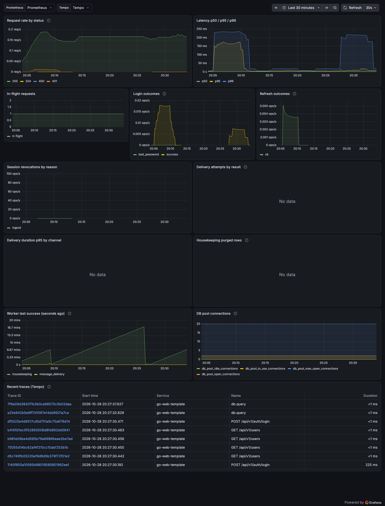

# 可观测性落地物

## 0. 本地一键看效果

```bash
make observability-up     # = compose --profile observability + metrics + OTel(→Tempo)
# 应用:       http://127.0.0.1:8080
# Prometheus: http://127.0.0.1:9090      （Status → Targets 里 go-web-template 应为 UP）
# Grafana:    http://127.0.0.1:3000/d/go-web-template （看板已自动装好，匿名只读）
# Tempo:      http://127.0.0.1:3200      （trace 存储；Grafana → Explore → Tempo → Search）
make observability-down   # 停止（保留 promdata/grafanadata/tempodata 卷）
```

追踪链路已内置：`otelgin` 为每个请求建 span，GORM 查询/投递 webhook/worker 任务挂在其下；
`make observability-up` 会把 `APP_OTEL_*` 指向 Tempo。日志里有 `trace_id`，响应头有 `X-Trace-Id`，
可以直接把用户报的 id 贴进 Grafana Explore（数据源选 **Tempo**，query type `TraceQL`，输入 trace id 或
`{ resource.service.name = "go-web-template" }`）。看板最下面的 `Recent traces (Tempo)` 表格也列出了最近
trace，点 Trace ID 即可打开 span 树。

> 注意：Grafana 的数据源 provisioning 只在启动时读取。改了 `grafana/provisioning/` 之后需要
> `docker compose -f deploy/docker-compose.yml --profile observability restart grafana`（看板文件每 30s 自动重载，不受影响）。

这三层**不是三选一**，而是一条链，任一层都可以单独用：

| 层 | 作用 | 只用到这一层时 |
|---|---|---|
| `/metrics`（应用） | 暴露指标文本（`prometheus/client_golang`） | 交给外部托管 Prometheus / VictoriaMetrics / 云监控抓取，不需要本仓库的 compose 服务 |
| Prometheus | 抓取、存储、告警规则求值（`prometheus/alerts.yml` 已挂载） | 直接用 Prometheus UI / PromQL 看，不装 Grafana |
| Grafana | 可视化（`grafana/dashboard.json` 已自动 provision） | 接已有 Prometheus 数据源，或导入 `dashboard.json` 到现有 Grafana |
| Tempo（可选） | 接收 OTLP、存储 trace（本地文件后端） | 换成 Jaeger/云厂商 trace 后端也行，应用侧只认 OTLP endpoint |

本地编排默认匿名只读（`GF_AUTH_ANONYMOUS_*`）只是为了开箱即看；生产必须关掉匿名并用 SSO/强密码。
规则已加载但没有 Alertmanager，所以「告警」在 Prometheus 的 `/alerts` 页面可见，不会真的发通知。



> 上图是本地跑起来后的实际截图（`make observability-up` + 少量登录/刷新/登出/列表请求）：
> 上半部分是指标，最下面 `Recent traces (Tempo)` 表格是 Tempo 里的 trace（点 Trace ID 打开 span 树）。
> `No data` 的面板是当前没有投递/清理活动，不是配置错误。

模板自带 Prometheus 指标（`/metrics`）、结构化访问日志与 `/readyz`，但「指标 + 看板 + 告警」
三件套才算闭环。这里放的是与代码同步维护的两份落地物：

| 文件 | 用途 |
|---|---|
| `tempo/tempo.yml` | 本地 Tempo 配置（OTLP 4317/4318 接收、本地文件存储、24h 保留） |
| `prometheus/prometheus.yml` | 本地编排用的抓取配置（目标 `app:8080`，加载下面的告警规则） |
| `prometheus/alerts.yml` | 告警规则（可用 `rule_files` 直接加载，或包成 prometheus-operator 的 `PrometheusRule`） |
| `grafana/dashboard.json` | Grafana 看板（uid 固定为 `go-web-template`；数据源变量默认选 `prometheus`） |
| `grafana/provisioning/` | 数据源（Prometheus + Tempo）+ 看板自动装载（`make observability-up` 时挂进容器） |
| `preview.png` | 本地跑起来后的看板截图（文档用） |

`build_info{version,commit}` 是一个值恒为 1 的指标：用它区分告警/看板对应的是哪个构建，避免翻容器日志。

## 1. 抓取配置

`/metrics` 默认开启，但 `deploy/docker-compose.yml`（生产式编排）默认 `APP_METRICS_ENABLED=false`：
它会暴露 Go 版本、路由清单与流量画像，生产应经内网/反代 ACL 抓取，而不是公网直出。

```yaml
# prometheus.yml
scrape_configs:
  - job_name: go-web-template
    metrics_path: /metrics
    static_configs:
      - targets: ["go-web-template.internal:8080"]
    # 多副本时用服务发现替代 static_configs，up{job=...} 告警按实例触发。
```

本地 compose 的等价配置在 `deploy/prometheus/prometheus.yml`（目标 `app:8080`，docker 网络内解析）。

需要 Prometheus 直接抓编排里的容器时，用 `APP_METRICS_ENABLED=true make docker-up`（只建议本地）。

## 2. 告警

```yaml
# prometheus.yml
rule_files:
  - deploy/prometheus/alerts.yml
```

规则分组：

| 组 | 规则 | 触发条件（模板默认） |
|---|---|---|
| availability | `AppDown` | `up{job="go-web-template"}==0` 持续 2m |
| availability | `High5xxRate` | 5xx 占比 > 5% 持续 10m |
| availability | `HighLatencyP95` | p95 > 1s 持续 10m |
| auth | `RefreshTokenReuseDetected` | 15m 内出现 `auth_refresh_total{result="reuse"}` |
| auth | `LoginFailureSpike` | 失败登录 > 5/s 持续 10m |
| auth | `AccountLockoutSpike` | 15m 内 > 3 次账号锁定 |
| message | `DeliveryDead` | 15m 内出现 `result="dead"` |
| message | `DeliveryFailureRatio` | 失败率 > 20% 持续 10m |
| message | `DeliveryLeaseLost` | 15m 内 > 5 次 `lease_lost`（重复投递风险） |
| operations | `HousekeepingTaskFailing` | 1h 内出现清理任务失败 |
| operations | `HousekeepingStalled` | 清理 worker 超过 2h 没有成功跑完 |
| operations | `MessageWorkerStalled` | 投递 worker 超过 15m 没有完成一轮 |
| operations | `RateLimitStoreErrors` | 5m 内出现 Redis 限流存储错误（已 fail-open） |

阈值是起点：先按自己的流量基线调 `for` 与阈值，再谈「告警不吵」。

## 3. 看板

`grafana/dashboard.json` 可直接导入（Dashboards → Import → 选择文件 → 绑 Prometheus 数据源）。
面板：请求速率/状态码、p50/p95/p99、在途请求、登录与刷新结果、会话吊销原因、投递结果与耗时、
保留期删除量、worker 最近成功时间（`worker_last_success_timestamp_seconds`）、数据库连接池
（`db_pool_*`，含等待计数/时长）。所有 label 都是闭集（`result`/`reason`/`task`/`channel`/`worker`/`path` 路由模板），
不含用户/邮箱/目标地址，所以不需要担心 PII 或高基数。

## 4. 与代码同步

指标名/label 由代码决定，改 `internal/*/metrics.go` 或 `internal/web/middleware_metrics.go` 时：

1. 同步本目录的两个文件（名字拼错 = 面板空白、告警永不触发）；
2. 在对应 `*_test.go` 里断言计数（见 `internal/auth/metrics_test.go`、`internal/message/worker_test.go`），
   否则「指标发出来了但 label 值变了」没人发现。
